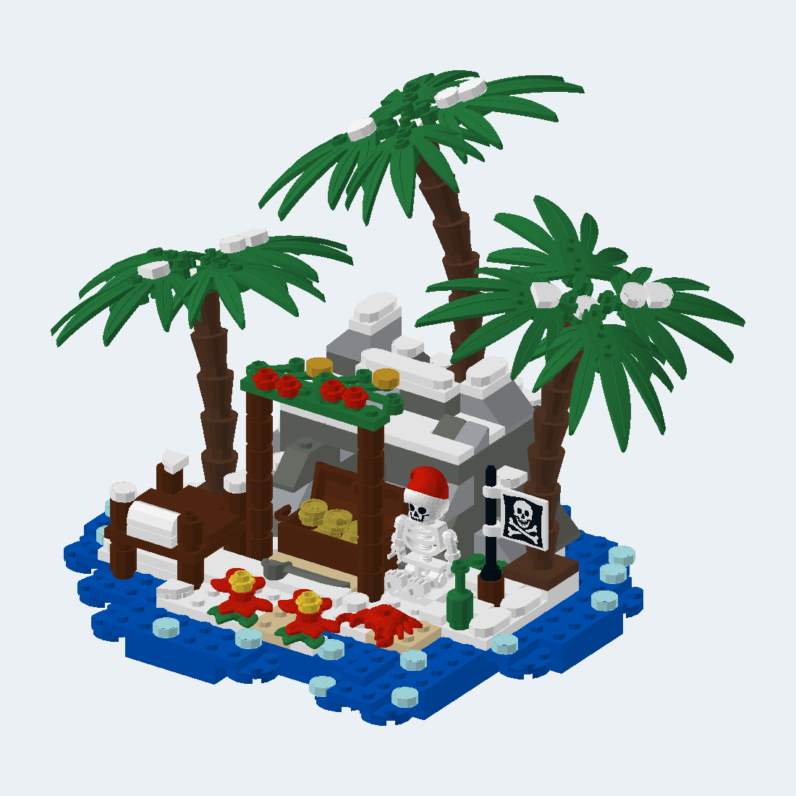

# Île du Trésor Oublié

Ouvrir **[Ile_du_Tresor_Oublie.io](Ile_du_Tresor_Oublie.io)** dans BrickLink Studio. Le modèle contient **415 pièces et 81 combinaisons pièce/couleur**, sur une base inchangée de **20 × 18 tenons**.



Le [rendu Studio original](Ile_du_Tresor_Oublie.png), d'environ 3 Mo, reste conservé. Il représente une version antérieure. `Ile_du_Tresor_Oublie_apercu.png` est l'aperçu du IO actuel produit par le script, sans texte ajouté.

## Détails de Noël — 14 octobre 2026

- Les **20 pièces d'or** sont réunies en vrac dans le coffre, avec des décalages et inclinaisons variés. Les deux éléments constituant l'ancien support intérieur sont retirés. Le fond réel du coffre sert d'appui ; les pièces sont libres et peuvent être sorties pour jouer.
- Le foulard rouge du squelette est remplacé par le **bonnet de Père Noël 10164pb04**, à dessus rouge moulé et bordure blanche. Sa géométrie est `bl_10164pb04.dat`, en blanc LDraw 15 / BrickLink 1. Cette référence évite l'ancien identifiant indéterminé 10164pb01, signalé comme destiné à suppression dans le catalogue.
- Deux **poinsettias stylisés** à l'avant associent les feuilles vertes et les bractées rouges `32607`, avec un centre jaune `24866`. Deux petites pièces de neige cèdent la place au feuillage ; la couche porteuse du socle reste identique.
- Une **guirlande de feuillage suspendue** surplombe le coffre. Deux poteaux bruns fixés au sol portent une plaque verte 1 × 6, masquée par des feuilles `2423`, des fleurs rouges et des touches dorées. Il s'agit d'un assemblage rigide, sans pièce flexible ni guirlande flottant sans fixation.

## Vérification de cette modification

Les **152 placements du socle et de sa couche neigeuse porteuse** sont conservés. Les ajouts ont des contacts détectés avec des tenons existants ; le bonnet partage la position et l'orientation de fixation de la tête. Les voisinages des fleurs sont examinés avec les triangles réels des pièces : aucun croisement de surfaces détecté entre leurs feuilles et le crabe, malgré un recouvrement de leurs boîtes englobantes.

Le placement de l'or utilise les surfaces triangulées et une grille de 0,5 unité LDraw (0,2 mm) pour poser les pièces sur le fond ou sur les autres pièces. Ce calcul approché ne constitue pas une simulation physique ni une validation native des collisions.

Le contrôleur d'inventaire du skill vérifie exactement références, couleurs, quantités et placements dans `model.ldr`, `modelv2.ldr`, `model2.ldr` et l'inventaire temporaire : **415 pièces, 81 combinaisons, aucun doublon**. Les nouvelles combinaisons sont attestées par les tables locales Studio, sauf le bonnet, attesté par sa [fiche BrickLink 10164pb04 en blanc](https://www.bricklink.com/v2/catalog/catalogitem.page?P=10164pb04&idColor=1). Les [feuilles 32607 rouges](https://www.bricklink.com/v2/catalog/catalogitem.page?ccName=6372723&id=160854&idColor=5) sont également répertoriées. Sources consultées le 14 octobre 2026 ; page du bonnet indexée depuis environ un mois, page des feuilles depuis un jour. Il ne s'agit pas d'une vérification de stocks ou de livraison en France.

Les vues avant et arrière de la géométrie réelle ont été inspectées. La stabilité et les collisions natives Studio, la construction physique et l'import effectif de cette nouvelle version sur BrickLink restent à confirmer. Le modèle précédent demeure dans l'historique Git. Les inventaires de travail et vues intermédiaires ne sont pas ajoutés au dossier.

Pour alimenter une Wanted List, importer directement ce IO sur BrickLink. Le fichier comprend les correspondances BrickLink dans `model2.ldr`. Aucun inventaire séparé n'est nécessaire pour cet usage.

## Outils partagés

Les outils de géométrie, de rendu et d'analyse des appuis sont partagés dans `../.agents/skills/lego-moc/scripts/`. Ils nécessitent Python, `numpy`, `Pillow` et la bibliothèque locale de Studio.

Depuis ce dossier, régénérer l'aperçu :

```powershell
python ../.agents/skills/lego-moc/scripts/render_moc.py Ile_du_Tresor_Oublie.io
```

Le script lit le modèle fourni en argument et écrit `Ile_du_Tresor_Oublie_apercu.png` à côté. Options : `--view front|back|bottom`, `--output chemin.png`, `--size 1100` et `--studio "chemin/vers/Studio 2.0"`. Le rendu simplifie l'éclairage et les matériaux et ne constitue pas une validation native des collisions ou de la stabilité.

Les archives, anciens aperçus, inventaires séparés et rapports ont été retirés du dossier de travail. Leur historique versionné reste disponible dans Git. La validation native Studio et la construction physique restent à confirmer.
