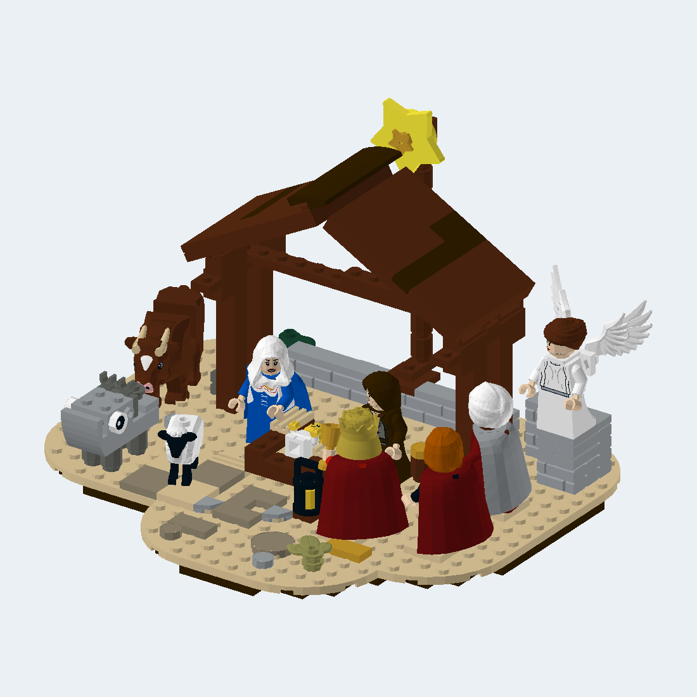

# Petite crèche

Ouvrir **[Petite_Creche.io](Petite_Creche.io)** dans BrickLink Studio.



Le modèle corrigé contient **367 pièces et 120 combinaisons référence/couleur**. Tous les éléments sont visibles et disposent d'une géométrie locale résolue. L'agencement principal et l'encombrement du socle sont conservés. La version avant correction est disponible dans Git au commit `06e4819`.

## Corrections du 14 octobre 2026

### Améliorations du décor

- Toit habillé de planches brunes décalées, avec quelques nuances Dark Brown et une couverture de faîtage arrondie.
- Étoile plus fine, Bright Light Yellow avec un petit centre doré ; support arrière raccourci et pointe longue orientée vers le bas.
- Mangeoire et parents avancés pour mieux montrer le bébé. Rois disposés en arc ouvert, sur des fixations centrées, avec les offrandes à proximité.
- Paille suggérée par des grilles Tan et lanterne noire à verre jaune translucide près de la mangeoire.
- Chemin irrégulier, touches de terre et de pierre et végétation basse, sans agrandir le socle.
- Poteaux affinés et traverse assemblée sous le toit. Âne retravaillé avec un corps plus fin, des yeux imprimés, des oreilles allongées et un museau arrondi.

La version précédant ces améliorations reste disponible dans Git au commit `afc04dc`. Les 122 pièces du socle conservent exactement leurs placements, géométries et couleurs. Les vues avant et arrière ont été inspectées ; les nouveaux voisinages rois/poteaux et végétation/murets ont également été contrôlés avec les géométries locales. Ces vérifications restent partielles : les collisions et la stabilité natives Studio n'ont pas été validées.

| Élément | Correction |
|---|---|
| Deux plaques 2 × 8 Dark Brown inexistantes | Chacune remplacée par deux plaques 2 × 4 `3020` Dark Brown. Enveloppe, épaisseur et positions des 16 tenons conservées pour chaque remplacement. |
| Tête du roi en Reddish Brown | Impression remplacée par le sourire classique `3626p01`, géométrie `3626bp01.dat`, sans changer la couleur chair ni la pose. |
| Tête de l'ange en Light Nougat | Remplacée par la tête féminine souriante `3626pb0635`, géométrie `3626cp0i.dat`, dans la même couleur chair. |
| Bébé | Corps blanc `25128pb001`, géométrie `25126p01.dat`, avec mains jaunes moulées ; tête `24581pb01` passée en Yellow. Les deux éléments ont une correspondance catalogue vérifiée et conservent leur position dans la mangeoire. |
| Couronne `71015` | Pearl Gold remplacé par Chrome Gold, couleur attestée pour cette référence. |
| Quatre capes | Correspondance `50231c01.dat` → BrickLink `522` explicitement établie. Les capes Blue et Dark Red sont conservées ; la cape Dark Tan est passée en Light Bluish Gray, couleur attestée. |
| Deux hanches | Correspondance `3815.dat` → BrickLink `970` confirmée, sans changer leur géométrie ou leurs placements. |
| Mouton | Référence corrigée en `bl_74188pb01.dat`, puis rendu visible. Ses quatre pieds reposent sur quatre tuiles Tan 2 × 2 formant une petite surface plane. |
| Âne | Référence sans géométrie `106470pb01.dat` retirée et remplacée par un **âne gris construit avec 17 pièces standard** : corps, tête, oreilles, yeux, museau et queue. Ses quatre appuis sont fixés sur les tenons du sol, près de l'emplacement prévu initialement. |
| Import BrickLink | Ajout de `model2.ldr`, avec identifiants et couleurs BrickLink explicites ; `model.ldr` et `modelv2.ldr` conservent les identifiants et couleurs géométriques LDraw. |

Le torse noir `973pa2` est conservé : le [catalogue BrickLink des torses présents dans des sets en Black](https://www.bricklink.com/catalogList.asp?catID=150&catType=P&catXrefLevel=0&colorPart=11) atteste cette combinaison, malgré l'échec de lecture de sa fiche détaillée lors du premier contrôle.

## Contrôles réalisés

- Archive ZIP intacte ; **367 placements identiques** entre `model.ldr`, `modelv2.ldr` et `model2.ldr` après conversion des références et couleurs. Aucun doublon exact.
- Contrôleur du skill exécuté sur **le modèle complet**, comparé au CSV et au XML de travail temporaires : couples référence/couleur et quantités identiques, pas seulement les totaux.
- **114 des 120 combinaisons** sont attestées dans la table locale des éléments Studio. Les six autres sont les torses imprimés ci-dessous, attestés dans le catalogue BrickLink.
- Toutes les géométries sont résolues ; plus aucun animal masqué ou référence DAT manquante. Aucun DAT personnalisé ni pièce flexible définie par des points de contrôle n'est ajouté.
- Les **quatre capes textiles** sont prises en compte dans l'inventaire et le rendu sous leur représentation LDraw formée fixe `50231c01.dat`. Elles ne sont ni omises ni comptées comme plusieurs pièces. Leur forme souple réelle reste à ajuster lors du montage.
- Connexions verticales des ajouts contrôlées avec les positions des tenons, connexions latérales des yeux et du museau de l'âne alignées. Les points les plus bas des pieds réels du mouton sont contenus dans la surface plane à la hauteur des tuiles.
- Recherche de chevauchements importants des nouveaux éléments et inspection des vues avant et arrière avec leur géométrie réelle. Ces contrôles partiels ne remplacent pas la validation native des collisions et de la stabilité dans Studio.

Les conversions de cape et de hanches ne sont pas déduites des numéros : le fichier LDraw local `522.dat` indique son remplacement par `50231c01`, et `3815.dat` indique son renommage depuis `970`. La [fiche BrickLink de la cape 522](https://www.bricklink.com/v2/catalog/catalogitem.page?C=11&P=522) liste également `50231` parmi ses références alternatives.

Les six combinaisons absentes de la table locale sont : [973p4n White](https://www.bricklink.com/v2/catalog/catalogitem.page?P=973p4n), [973p4e Red](https://www.bricklink.com/catalogItemIn.asp?P=973p4e), [973pb1139 Dark Brown](https://www.bricklink.com/v2/catalog/catalogitem.page?P=973pb1139), [973pb0583 Dark Red](https://www.bricklink.com/v2/catalog/catalogitem.page?P=973pb0583), [973px86a White](https://www.bricklink.com/v2/catalog/catalogitem.page?P=973px86a) et `973pa2 Black`, attesté par la page des torses noirs citée plus haut.

Sources consultées le 14 octobre 2026 ; leurs indexations datent du jour même à plusieurs mois selon les fiches. **Aucune combinaison pièce/couleur non attestée ne reste identifiée dans ce modèle corrigé.** Cela ne garantit pas les stocks, les quantités commandables, la livraison en France ou le résultat d'Easy Buy.

L'import effectif dans une Wanted List, la validation native Studio des connexions/collisions/stabilité et la construction physique restent à confirmer. La correction d'achat est incluse directement dans le IO ; aucun inventaire séparé n'est nécessaire dans ce dossier.

## Régénérer l'aperçu

Depuis ce dossier, avec Python, NumPy, Pillow et la bibliothèque Studio installés :

```powershell
python ../.agents/skills/lego-moc/scripts/render_moc.py Petite_Creche.io
```

Le script générique peut désormais lire et rendre tout le modèle directement. Le rendu utilise la géométrie réelle, avec des matériaux simplifiés et sans texte ajouté. Les inventaires temporaires et vues de contrôle ne sont pas conservés dans le dossier.
