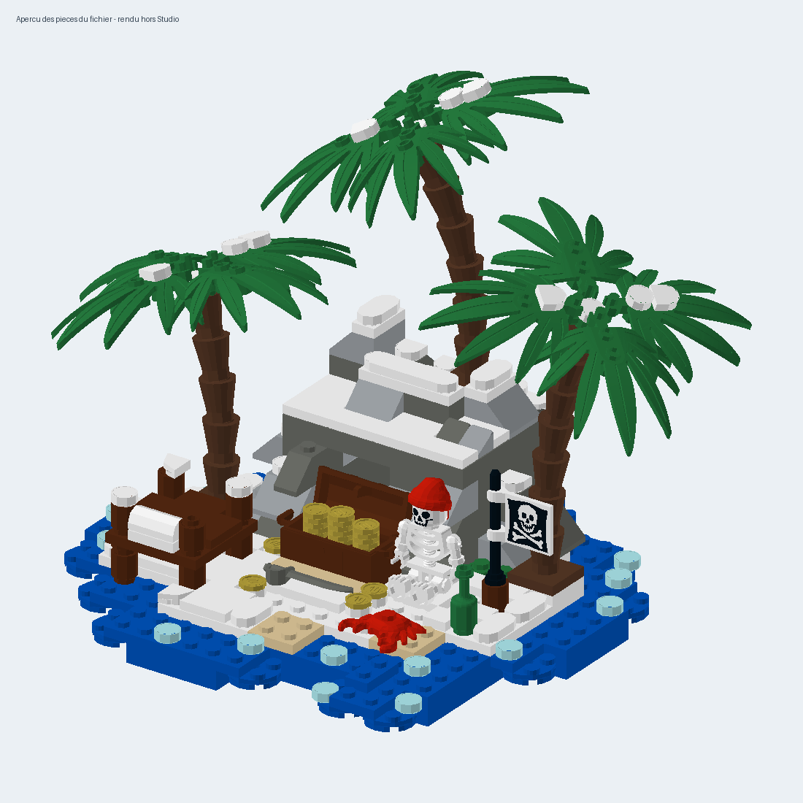

# Mes MOC LEGO

Modèles personnels créés avec BrickLink Studio, inventaires d'achat, aperçus et outils de vérification.

## Modèles

- [Île du Trésor Oublié](Ile_du_Tresor_Oublie/) : petite île enneigée pour une ville de Noël.
- [Mariah Noël](Mariah_Noel_V2_7_spots_fins_robe_restauree.io)
- [Petite crèche](Petite_Creche_V2_2.io)
- [Portail Nether](Portail_Nether_V4_Centre_Transparent.io)
- [Wagon tombereau](Wagon_Tombereau_V2_1_Fond_Brun_Lisse.io)

Les fichiers des quatre derniers modèles sont conservés tels quels ; leurs inventaires et leur constructibilité n'ont pas été audités ici.

## Île du Trésor : version à utiliser

Ouvrir [V3.6 corrigée pour BrickLink](Ile_du_Tresor_Oublie/Ile_du_Tresor_Oublie_V3_6_bricklink.io). Elle comprend **391 pièces et 76 combinaisons référence/couleur**, sur une base de 20 × 18 tenons. Les versions précédentes sont conservées comme historique ; les anciens IO générés peuvent présenter des erreurs lors de l'import direct sur BrickLink.



Le [XML d'achat](Ile_du_Tresor_Oublie/Ile_du_Tresor_Oublie_V3_6_wanted_list.xml) doit être collé dans l'onglet **Upload BrickLink XML format**, et non sélectionné dans l'onglet d'import de fichiers. Utiliser une nouvelle Wanted List vide pour éviter l'addition des quantités.

Les contrôles locaux valident la cohérence des inventaires et des fichiers internes. La validation native de stabilité/collision, la construction physique et le succès d'Easy Buy ne sont pas encore confirmés. Les rapports de vente décrivent des offres affichées à la date du contrôle, avec leur ancienneté ; ils ne garantissent pas le stock instantané ou la livraison.

## Règles et outils

- [AGENTS.md](AGENTS.md) fixe les règles de travail communes.
- [Skill lego-moc](.agents/skills/lego-moc/SKILL.md) contient la méthode et le vérificateur réutilisable. Une copie locale existe aussi dans le dossier personnel des skills Codex.
- Les scripts présents dans le dossier de l'île documentent ses transformations successives. Plusieurs génèrent des fichiers dès leur exécution : les inspecter avant de les réutiliser.

Contrôle de l'inventaire sous PowerShell, depuis la racine du dépôt :

```powershell
python .agents/skills/lego-moc/scripts/check_inventory.py Ile_du_Tresor_Oublie/Ile_du_Tresor_Oublie_V3_6_bricklink.io --inventory Ile_du_Tresor_Oublie/Ile_du_Tresor_Oublie_V3_6_pieces.csv --xml Ile_du_Tresor_Oublie/Ile_du_Tresor_Oublie_V3_6_wanted_list.xml
```

Python et les tables de couleurs d'une installation locale de Studio sont nécessaires. Ajouter `--studio "chemin/vers/Studio 2.0"` si l'installation utilise un autre emplacement.
